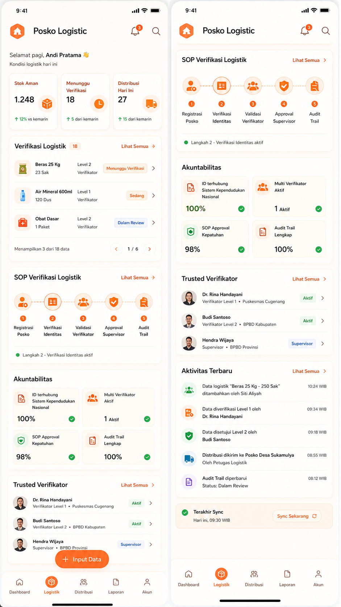

# Rescue-Net

Rescue-Net membantu lembaga berkoordinasi dalam tanggap darurat dan pemulihan. Sistem ini mendukung pengelolaan posko, logistik, relawan, shelter, layanan medis, pencarian, donor, dan pemulihan. Federasi memungkinkan instansi bertukar data sesuai kebijakan masing-masing. Disaster Management System (DMS) Edisi Instansi menyediakan ruang kerja tertutup bagi instansi.

## Tampilan



*Mockup dasbor logistik dengan data simulasi.*

## Arsitektur

Antarmuka web terdiri dari HTML, CSS, dan JavaScript. Nginx menyajikan antarmuka dan meneruskan permintaan ke Frappe v15 dengan aplikasi Rescue-Net dan ERPNext. MariaDB menyimpan data dan Redis mendukung antrean dan cache. Baca bab 1, 13, dan 14 di [Manual Teknis](pages/manual-teknis.html) serta [dokumen arsitektur dan federasi](docs/).

## Instalasi cepat

Siapkan Linux 64-bit, Docker Engine dan plugin Compose, minimal 2 CPU, RAM 4 GB, dan disk 20 GB.

```sh
git clone https://github.com/bagushandhoko/rescue-net.git
cd rescue-net/node
./pasang.sh
```

Buka [Rescue-Net di server lokal](http://127.0.0.1:8182/rescue-net/). Lihat [panduan node](node/README.md) untuk konfigurasi, cadangan, dan pemulihan.

## Pengujian dan kontribusi

Dari direktori utama repo, jalankan `sh scripts/rn-test-stack.sh test`. Lihat [panduan kontribusi](CONTRIBUTING.md), [panduan operator](docs/OPERATOR.md), dan [cara melaporkan celah keamanan](SECURITY.md).

## Lisensi

[Apache License 2.0](LICENSE). Lihat juga [NOTICE](NOTICE).
